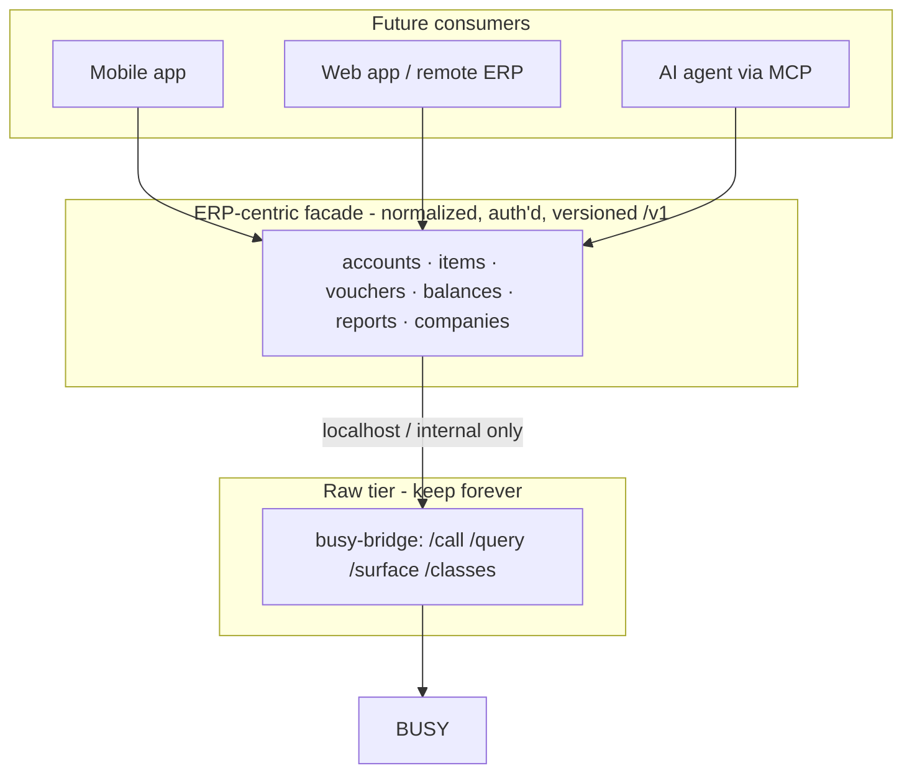
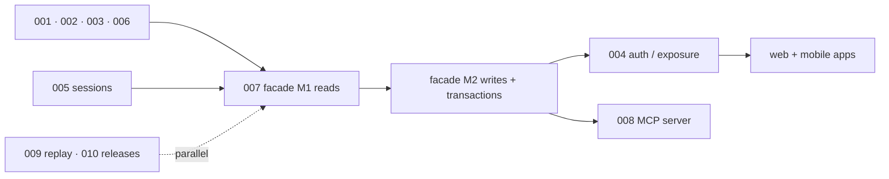

# Roadmap & future direction

> Status 2026-10-08, grounded in a live analysis of BUSY Rel 14's installed
> surface (925 classes / 4,496 core members) — not in the 2017 documents.
> Concrete work items: [`issues/`](issues/).

## Where we are

The **raw tier is complete**: `busy-bridge` exposes every registered BUSY
class over a validated JSON/XML wire contract, in enforceable layers, with
docs (guides + full archive + generated reference) and live tests.

**H0 is done** (2026-10-09): runtime ProgID discovery (001), contract
hardening (002), guarded query (003), and voucher write validation (006)
are all implemented and covered by the nine live suites in
`tests/live/` (full `run-all.ps1` green against DEMO). Token auth +
exposure policy (004) is also closed — non-loopback bind requires a token.

**H1 is done** (2026-10-09): the ERP facade (007) ships as `core/ops`
+ CLI `op` + HTTP `/v1` with opaque keyset cursors; multi-company serve
(005) is swap-based `?comp=`/`X-Company`. Eleven live suites green.

**What remains is consumers (H2)**: web/mobile apps against `/v1`, and
the MCP adapter (008 — blocked by neither 007 nor 004 anymore).

Verb-clustering of the 16 core classes reveals the shape of what's next:

| Signal | Count (approx.) | Implication |
|---|---|---|
| `Get*` members | ~1,900 | read-dominant surface → **perfect for app-facing GET resources** |
| `Save*`/`Add*`/`Create*` | ~200 | writes are few, document-shaped → map cleanly to POST resources |
| `Check*`/`Can*`/`If*` | ~400 | pre-flight/authorization vocabulary → belongs in the facade, not in clients |
| unclassified gems | 480+ | `BeginTran`/`CommitTran`, `BackupCSDataBase`, `ApplyPatchOn*`, `*ForAuthorisation`, `AskYesNo`, `ConfigMobileAppSeries`, `ConnectClient2CompInfoDB` |

Notable discoveries from this pass:

- **Transactions exist**: `BeginTran`/`CommitTran`/`Rollback?`-style APIs mean
  multi-write operations can be atomic — a facade can offer batch POSTs.
- **Authorization primitives** are exposed (`CanModifyMasterForAuthorisation`,
  `ChkUserRightsForGSTConfiguration`) — the facade can enforce, not just pass through.
- **BUSY itself has mobile-app concepts** (`ConfigMobileAppSeries`) — our mobile
  story should interoperate, not collide.
- **COM can raise UI** (`AskYesNo`, `BrowseFile`) — headless callers must never
  hit those paths; the facade should block/wrap them.

## Architectural stance (decision record)

1. **Raw stays** — it is the database driver; foundation for everything, loopback-only,
   never internet-facing, never what apps/MCP consume directly.
2. **A resource facade is the product surface** for apps — built when the first real
   consumer starts (trigger rule), designed *now* in [`issues/007-erp-facade-rfc.md`](issues/007-erp-facade-rfc.md).
3. **MCP is a thin adapter over the facade** — ~10–30 tools, never 4,496.
4. **Normalization must not discard the escape hatch**: raw `/call` remains for
   statutory/odd corners.
5. **File-size policy (issue 011)**: ≤400 physical lines per `src/**/*.zig`
   (≤200 per live-test `.ps1`), enforced by `scripts/check_size.ps1`
   (structure gate). Exceeding it requires a split or an allowlist entry
   carrying a written reason — no large files unless explicitly by design.
6. **Repo split (COM lib vs server): deferred, triggers recorded.** The
   `core/` ↔ `transport/` layer line is the future cut and is already
   enforced by `check_layers.ps1`; revisit only when a second *in-process*
   consumer of `core` appears or independent release cadence is needed
   (review at issue 010). Precondition: issue 011 restructure lands —
   barrels make the split a `git mv` + `build.zig` edit.

## Horizons

### H0 — Harden the contract ✅ *(done 2026-10-09)*
- [`001-runtime-progid-discovery.md`](issues/001-runtime-progid-discovery.md) — stop hardcoding `Busy2L21` (next BUSY upgrade breaks the default today)
- [`002-contract-hardening.md`](issues/002-contract-hardening.md) — `constants.json`, `GET /info`, machine-readable error codes
- [`003-guarded-query.md`](issues/003-guarded-query.md) — SQL safety modes before anything is exposed
- [`006-voucher-write-validation.md`](issues/006-voucher-write-validation.md) — close the last live-test gap (`SaveVchFromXML` never validated; `Tran1` returns *no recordset* — semantics need documenting)

### H1 — The facade *(v1 surface for apps)* ✅ *(done 2026-10-09)*
- ~~[`007-erp-facade-rfc.md`](issues/007-erp-facade-rfc.md)~~ — ✅ closed 2026-10-09 (core/ops + CLI `op` + HTTP `/v1` with opaque keyset cursors; live suite 11)
- ~~[`005-multi-company-sessions.md`](issues/005-multi-company-sessions.md)~~ — ✅ closed 2026-10-09 (swap-based `?comp=`/`X-Company` in serve; pool impossible — BUSY COM state is process-global first-open-wins; ~7s per swap)
- ~~[`004-remote-exposure-auth.md`](issues/004-remote-exposure-auth.md)~~ — ✅ closed 2026-10-09 (token auth + exposure policy, live suite 09)

### H2 — Consumers
- Web/mobile apps against `/v1` (blocked by H1 + 004).
- [`008-mcp-server.md`](issues/008-mcp-server.md) — MCP tools over the facade; `surface` as an introspection *resource* (blocked by 007).

### H3 — Engineering operations
- [`009-record-replay-ci.md`](issues/009-record-replay-ci.md) — replay COM fixtures in CI (live BUSY can't run on runners)
- [`010-release-artifacts.md`](issues/010-release-artifacts.md) — tags, checksummed x86 artifacts, real versioning (0.1.0 is currently hardcoded)
- Docs policy: regenerate `function-reference.md` after every BUSY upgrade (script exists; requires the machine with BUSY); archive is immutable.

## Known constraints (documented, not planned for change)

| Constraint | Consequence |
|---|---|
| COM is **STA / single-threaded** | `serve` handles requests serially; concurrency = multiple processes each with their own company session, never shared |
| One open company per data directory | headless bridge and BUSY GUI must not open the same company (crash risk, observed) |
| 32-bit only | bridge is x86; 64-bit clients must go through HTTP |
| DEMO has no vouchers | write paths for vouchers covered by unit tests only until issue 006 |
| PowerShell 5.1 quirks | `--args-b64`, raw `HttpWebRequest` in tests — keep harnesses in-repo |

## Non-goals

- No GUI scraping / screen automation (the .NET `WebDriver` lib is BUSY's, not ours).
- No raw internet exposure of `/call` `/query` — ever (issues 003 + 004 are the gate).
- No rewrite or removal of the raw tier; it is the contract, not scaffolding.
- No speculative multi-ERP abstraction — this is BUSY-specific depth, deliberately.

## Suggested sequencing

